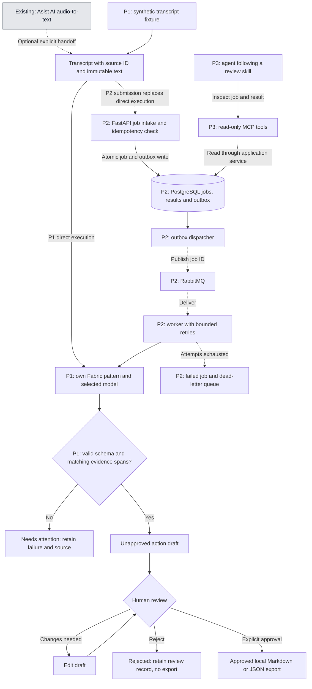

# Proposal: from voice notes to reviewed actions

Status: **experimental design for discussion — not implemented**.

The existing Asist AI application transcribes audio locally and writes text to the clipboard. This proposal adds an optional path from a transcript to evidence-backed action drafts. It does not replace the desktop workflow.

## User story

I dictate or supply a technical note. The system proposes actions, decisions and open questions, showing the source text behind each item. I review the proposal before exporting a local draft. Missing owners and dates stay unknown.

Example input:

> The sync job duplicated two records after a retry. We should investigate the idempotency key. We have not agreed who will do it or when.

Expected draft: investigate the idempotency key; owner and due date are `null`; the suggestion remains **proposed**, not an agreed commitment. Its evidence points to the second sentence. The system must not invent an assignee or deadline.

## Target flow

Only the gray input node represents existing functionality. Every other node below is proposed. Phase labels define implementation order, not already available features. Phase 1 runs directly from a transcript fixture; the API, database and queue are added only in Phase 2.

The worker persists draft or failure state before acknowledging a message. Duplicate delivery returns the existing result rather than adding another action set. Queue retries are bounded and delayed; invalid model output requires attention rather than an unlimited retry loop. The database is the source of truth; the queue carries job identifiers.

An outbox makes job creation and the intent to publish atomic. It does not promise exactly-once delivery: the consumer still needs idempotency, and a crash can cause another model call even when the final stored result is deduplicated. Recovery from a worker that dies while holding a job needs an explicit lease/claim policy.

The schema/evidence gate checks structure and whether quoted spans exist. It **cannot prove semantic correctness**: a model may misinterpret a real quote. Human review and the evaluation dataset address that separate risk. Failure with no approved result must remain visibly different from a valid result containing zero actions.

## Proposed contract

| Field | Meaning |
| --- | --- |
| `source_id`, `source_hash` | Stable source identity and hash of the exact transcript |
| `job_id`, `pipeline_version` | Processing attempt context and versioned extraction/validation logic |
| `actions[]` | Proposed action, nullable owner/date, commitment status and evidence spans |
| `decisions[]`, `questions[]` | Decisions actually stated and unresolved questions, each with evidence |
| `review_status` | Pending, approved or rejected; model output cannot approve itself |
| `pattern_version`, `model_id` | Reproducible description of the inference configuration |

Idempotency is scoped to source identity/hash plus pipeline version. Re-evaluating a changed pattern creates a new versioned result rather than silently overwriting the old one. Exact field types and state transitions are part of task A1.

## Implementation slices and acceptance criteria

All tasks below are **not started**. Complete A1–A3 before adding infrastructure.

| ID | Task | Depends on | Done when |
| --- | --- | --- | --- |
| A1 | Define transcript/action schema and five hand-labelled examples | — | Examples cover a commitment, a suggestion, missing owner/date, no actions, and an embedded malicious instruction; expected behavior is explicit |
| A2 | Create `extract_actions_with_evidence` and a thin Fabric adapter | A1 | One command produces a validated draft from a fixture; original input and unmodified model output are preserved; provider failure is explicit |
| A3 | Build an evaluation runner and expand to 20–30 examples | A2 | Separate development and held-out sets; report invented/omitted actions, evidence correctness, null-field handling, time and cost when available; baseline comparison and human review are recorded |
| A4 | Add FastAPI, PostgreSQL job states and outbox | A3 | Repeated submission returns the same job; a database rollback cannot leave a published job without a record; publication recovery is demonstrated |
| A5 | Add RabbitMQ, worker and recovery tests | A4 | Duplicate delivery does not duplicate stored results; transient failure retries with backoff; exhausted attempts go to a failed state/DLQ; worker restart and stale claims recover predictably |
| A6 | Expose read-only MCP tools and a review skill | A5 | Agent can use `get_job_status` and `get_job_result`; it handles unknown IDs, failure and untrusted transcript instructions; it cannot approve/export or write to external systems |
| A7 | Publish the case and a short demo | A6 | Fresh setup works; show success, duplicate delivery, failure recovery and a rejected draft; include limitations and measured results |

Suggested first implementation PR: **A1 only**. Agree on the contract and examples before choosing a model or writing the adapter. This experimental branch is documentation-only, not that implementation PR.

## How evaluation differs from unit testing

- **Deterministic tests:** schema rules, evidence offsets, job state transitions, idempotency and permissions. Mock provider failures here.
- **Real-model evaluations:** run labelled transcripts with a pinned pattern/model configuration; repeat a subset to expose variability. A mock response is never evidence of model quality.
- **Skill evaluations, in Phase 3:** assess actual agent tool calls and the final response. Include when to ask for clarification, when no tool is needed, and attempts to trigger unauthorized actions. Merely checking that a `SKILL.md` exists is insufficient.
- **Release decision:** compare against a simple extraction baseline, inspect failures and agree on thresholds before evaluating the held-out set. No quality score or passing threshold is claimed yet.

## Decisions to discuss before implementation

1. **First task:** technical-note action extraction is the proposed use case. Confirm it before adding meeting summaries or other document types.
2. **Model and budget:** local or hosted inference, explicit data handling, a per-run cost limit, and a model/version to evaluate. Local transcription does not make a hosted extraction step offline.
3. **Fabric contribution:** keep the adapter and evaluation dataset here. Create a fork when there is a focused pattern or code change worth contributing; retain upstream attribution. A fork itself is not the portfolio contribution.
4. **Approval and storage:** choose a simple CLI review/export interaction first and define transcript retention. No Jira/Slack/email writes or employer data are part of this experiment.
5. **Agent scope:** initially inspect and explain existing results. Add autonomous decisions only when the deterministic workflow has a demonstrated gap.

## Scope boundaries

No Kubernetes, multi-agent orchestration, vector database, new frontend or live workplace integration is needed for the first slice. Audio capture and Whisper accuracy remain separate from extraction quality: first evaluate controlled transcripts, then measure the effect of transcription errors.

The evidence we want to show is: a useful workflow, explicit contracts, honest model-quality measurements, observable failures and recoverable backend execution. The current application and its existing demo remain the baseline.
